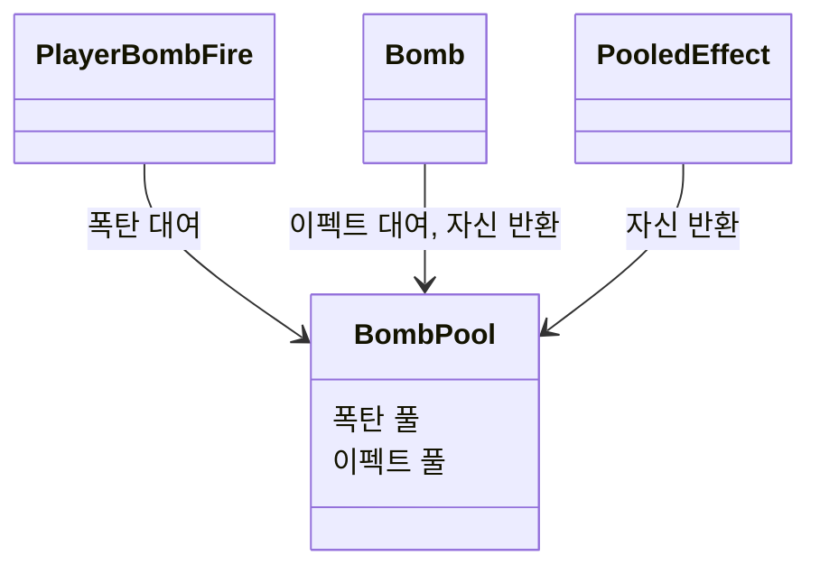

# 폭탄 오브젝트 풀링 설계

설계 수준: **Level 1** (클래스 책임 중심 설계)

## 1. 기능 개요 및 요구사항

- **목적:** 폭탄 투척 시마다 반복되는 폭탄·폭발 이펙트의 생성(`Instantiate`)과 파괴(`Destroy`)를 오브젝트 풀링으로 대체한다.
- **범위:** 폭탄 오브젝트와 폭발 이펙트 오브젝트 모두 풀링한다.
- **제약:**
  - 풀은 Unity 내장 `UnityEngine.Pool.ObjectPool<T>`를 사용한다. (프로젝트 Unity 버전 6000.3.22f1에서 지원)
  - 풀 소유는 씬에 하나 두는 `BombPool` 컴포넌트가 맡는다.
  - 서드파티 원본 이펙트 프리팹은 수정하지 않고 Prefab Variant를 만들어 사용한다.
- **제외 범위:** 폭탄 외 다른 무기·이펙트의 풀링, 범용 풀 매니저, 폭탄 투척·탄약·폭발 판정 규칙의 변경.

## 2. 기존 구조와 변경 범위 요약

**확인된 기존 구조**
- `PlayerBombFire`가 우클릭을 뗄 때 폭탄 프리팹을 `Instantiate`하고 Rigidbody에 힘을 가한다. 탄약 수, 홀드 시간, 투척 힘 계산과 UI 갱신도 이 클래스가 한다.
- `Bomb`은 충돌 시 폭발 이펙트를 `Instantiate`하여 재생하고 `Destroy(gameObject)`로 자신을 제거한다. 이 위치에 `// TODO: Object pooling` 주석이 있다.
- 폭발 이펙트 원본(`Explosion.prefab`)의 루트 ParticleSystem은 재생 종료 시 Destroy 동작(`stopAction: 2`)으로 설정되어 있어, 풀링하려면 이 동작을 바꿔야 한다.
- 프로젝트에 풀링 관련 코드는 없다.

**새로 추가하거나 책임이 바뀌는 대상 (제안)**
- 신규: `BombPool`, `PooledEffect`, 폭발 이펙트 Prefab Variant
- 수정: `PlayerBombFire`(폭탄 프리팹 직접 보유 → 풀에서 대여), `Bomb`(이펙트 프리팹 보유·생성·자기 파괴 → 풀에서 이펙트 대여·자기 반환)

## 3. 클래스별 책임

| 클래스 | 구분 | 책임 |
|---|---|---|
| `BombPool` | 신규 | 폭탄 프리팹과 이펙트 프리팹을 소유하고 두 풀의 생성·대여·반환을 관리한다. 풀 객체의 활성화·비활성화 시점의 공통 처리도 맡는다. `Bomb`과 `PooledEffect` 타입은 알지만, 폭탄·이펙트의 동작 규칙과 수명 판단은 각 대상이 담당한다. |
| `PlayerBombFire` | 수정 | `BombPool`에서 폭탄을 받아 발사 위치에 놓고 던진다. 탄약 수, 홀드 시간, 투척 힘 계산과 UI 갱신은 기존대로 유지한다. 폭탄 프리팹은 더 이상 직접 보유하지 않는다. |
| `Bomb` | 수정 | 충돌하면 `BombPool`에서 이펙트를 받아 충돌 위치에서 재생하고 자신을 풀에 반환한다. 반환 시 이동 상태(속도·회전)를 초기화할 책임이 있다. 이펙트 프리팹 참조와 `Instantiate`/`Destroy` 호출은 제거된다. |
| `PooledEffect` | 신규 | 이펙트 프리팹에 붙어, 이펙트 전체(루트와 자식 파티클 시스템 모두)의 재생이 끝나면 자신을 `BombPool`에 반환한다. 루트만 끝난 시점에는 반환하지 않는다. 구체적인 종료 감지 방식은 Level 2에서 결정한다. |
| 폭발 이펙트 Prefab Variant | 신규 에셋 | 서드파티 `Explosion.prefab`을 기반으로 만든다. 재생 종료 동작을 Destroy에서 Callback으로 바꾸고 `PooledEffect`를 포함한다. |

## 4. 핵심 클래스 관계 및 설계 원칙

**의존 방향**
- `PlayerBombFire`, `Bomb`, `PooledEffect`가 모두 `BombPool`을 향해 의존한다. `BombPool`은 `PlayerBombFire`에 의존하지 않으며, 풀링 대상인 `Bomb`과 `PooledEffect` 타입만 안다.

**승인된 설계 결정과 근거**
- **폭탄과 이펙트 모두 풀링:** 둘 다 생성·파괴 패턴이 동일하고, 코드의 TODO도 이펙트 생성 쪽에 있다.
- **내장 `ObjectPool<T>` 사용:** 직접 만든 풀 클래스보다 유지할 코드가 적고 생성·대여·반환·파괴 콜백을 이미 제공한다.
- **풀 소유를 `BombPool` 단일 컴포넌트로 통합:** 풀 소유자를 `Bomb`에 두면 폭탄 인스턴스마다 이펙트 풀이 따로 생겨 풀링 의미가 사라진다.
- **반환 책임은 각자 자기 수명을 아는 쪽이 진다:** 폭탄은 충돌 시, 이펙트는 전체 재생 종료 시 스스로 반환을 요청한다.
- **이펙트 반환 시점은 전체 재생 종료:** 원본 이펙트는 루트(수명 0.2~0.35초)와 자식 파티클 시스템(연기 등 최대 1.5~2초)으로 구성되어 있어, 루트 종료 시점에 반환하면 자식 연출이 잘릴 수 있다. `BombPool`은 수명 판단에 관여하지 않는다.
- **이펙트는 Prefab Variant로 사용:** 서드파티 폴더(`10.ThirdParty`)의 원본을 수정하지 않는다.
- **구성 변경:** `PlayerBombFire`가 갖던 폭탄 프리팹 참조와 `Bomb`이 갖던 이펙트 프리팹 참조가 `BombPool`로 이동한다. 이에 따른 씬·프리팹의 연결 변경 절차는 Level 2에서 다룬다.

**미결정 사항 (Level 2에서 결정)**
- 풀의 초기 크기와 최대 크기
- `Bomb`과 `PooledEffect`가 `BombPool` 참조를 얻는 방식
- `PooledEffect`가 이펙트 전체 재생 종료를 감지하는 방식 (Prefab Variant의 재생 종료 동작 설정 포함)
